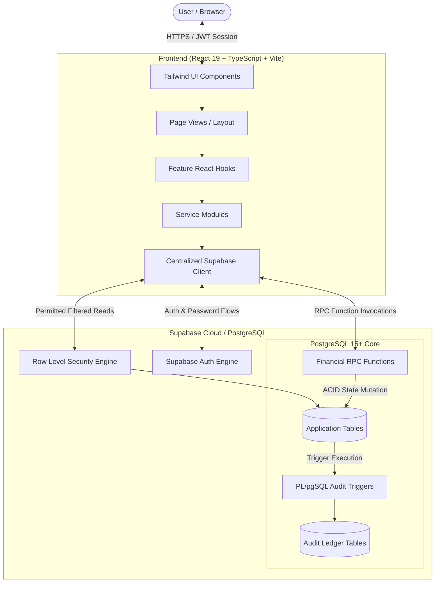
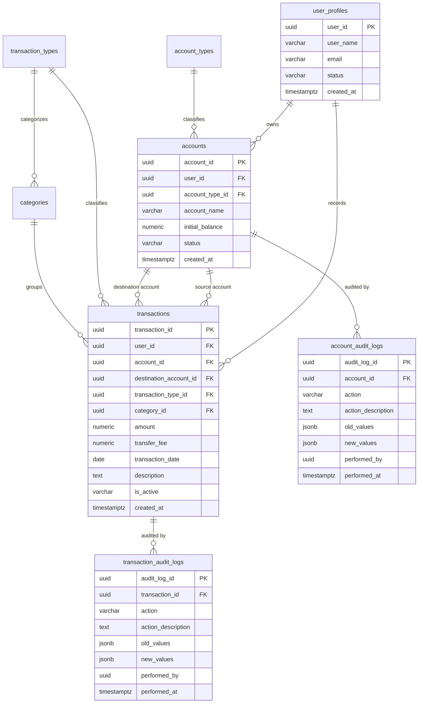

# FinTrack — Cross-Device Personal Finance Management

[](https://www.typescriptlang.org/)
[](https://react.dev/)
[](https://tailwindcss.com/)
[](https://supabase.com/)
[](https://vitejs.dev/)
[-emerald.svg)](#financial-rules--currency-standard)

**FinTrack** is an enterprise-grade, cross-device personal finance management responsive web application built with **React 19**, **TypeScript**, **Tailwind CSS**, and backed directly by **Supabase Auth** and **PostgreSQL**.

Designed specifically for the Philippine financial landscape (with native support for Cash Wallets, Maya, GCash, Bank Accounts, and Credit Cards), FinTrack replaces manual spreadsheets and opaque tracking apps with **cryptographic row-level security**, **database-authoritative financial calculation**, and **comprehensive atomic audit logging**.

---

## Table of Contents

- [1. Project Overview & Core Philosophy](#1-project-overview--core-philosophy)
- [2. System Architecture](#2-system-architecture)
- [3. Key Features](#3-key-features)
- [4. PostgreSQL Financial RPC Engine](#4-postgresql-financial-rpc-engine)
- [5. Database Schema & Data Dictionary](#5-database-schema--data-dictionary)
- [6. Audit Trail & Ledger Mechanics](#6-audit-trail--ledger-mechanics)
- [7. Frontend Architecture & Folder Structure](#7-frontend-architecture--folder-structure)
- [8. Security & Row Level Security (RLS)](#8-security--row-level-security-rls)
- [9. Getting Started & Installation](#9-getting-started--installation)
- [10. Production Build & Optimization](#10-production-build--optimization)
- [11. Available Scripts](#11-available-scripts)

---

## 1. Project Overview & Core Philosophy

In traditional personal finance apps, account balances are often stored as editable scalar columns in a database table or computed opportunistically in client-side code. This exposes records to race conditions, synchronization drift, negative balance vulnerabilities, and manual tampering.

FinTrack enforces an **authoritative financial engine** guided by three non-negotiable principles:

1. **Zero Editable Scalar Balances:** Current account balances are never stored as static scalar numbers. Instead, each account's balance is dynamically and authoritatively derived inside PostgreSQL via `calculate_account_balance(account_id)`:
   $$\text{Balance} = \text{Initial Balance} + \sum(\text{Active Inflow}) - \sum(\text{Active Outflow}) - \sum(\text{Transfer Fees})$$
2. **ACID Financial RPC Functions:** All financial state changes (recording income, logging expenses, executing transfers, editing transactions, or soft-deleting entries) are strictly prohibited through direct `INSERT` / `UPDATE` / `DELETE` table queries. They must execute via vetted PostgreSQL stored procedures called through Supabase RPC.
3. **Database-Level Atomic Audit Logging:** Every creation, modification, deactivation, or soft deletion generates an immutable audit record inside the exact same database transaction via PL/pgSQL triggers. If audit generation fails, the financial operation rolls back automatically.

---

## 2. System Architecture

FinTrack employs a **serverless client-to-database architecture** that completely removes the overhead and vulnerability surface of a separate Node.js/Express backend layer.



### Communication Flow:
1. **Authentication:** Managed by Supabase Auth with secure JWT tokens stored in browser session storage / local storage.
2. **Reads:** Safe queries (e.g. fetching account lists, category options, transactions) run through the `@supabase/supabase-js` client, governed by strict per-user PostgreSQL Row Level Security policies.
3. **Writes:** All write operations run via trusted `supabase.rpc('<function_name>', { ... })` calls.
4. **Validation:** The PostgreSQL engine validates inputs, checks for negative balance overdrafts, verifies user ownership, locks records against concurrent race conditions, updates rows, and triggers audit insertion within an atomic transaction.

---

## 3. Key Features

### 3.1 Multi-Account Financial Management
- **Pre-provisioned Default Cash Wallet:** Every newly registered user automatically receives an active Cash Wallet via an atomic signup trigger.
- **Support for Varied Account Types:** Cash Wallets, Bank Accounts (BDO, BPI, UnionBank, Metrobank, etc.), Mobile Wallets (GCash, Maya), and Credit Cards.
- **Initial Balance Locking:** An account's opening balance can be configured during creation. Once transactions are recorded against the account, the initial balance is permanently locked to protect mathematical integrity.
- **Zero-Balance Deactivation Enforcement:** Accounts can only be deactivated if their computed balance is exactly `₱0.00`. An account with active funds cannot be deactivated.
- **Active Account Retention:** The system prevents users from deactivating their last remaining active account.

### 3.2 Transaction Management
- **Income Records:** Credited to an active receiving account, categorized by type (Salary, Business Income, Allowance, Investments, etc.).
- **Expense Records:** Debited from an active account with real-time overdraft verification. If spending exceeds the account's balance, the transaction is rejected.
- **Atomic Account Transfers:** Moves funds between two accounts belonging to the authenticated user. Supports optional **Transfer Fees** deducted from the source account and tracked separately in financial analytics.
- **Restricted Transaction Editing:** Allows updating categories, amounts, descriptions, and account assignments on Income and Expense transactions. Date and transfer records are immutable.
- **Soft-Deletion with Automatic Balance Reversal:** Transactions are never physically destroyed (`status = 'N'`). Deleting a transaction immediately reverses its balance impact while preserving full audit history.

### 3.3 Dashboard & Financial Analytics
- **Live Summary Metrics:** Total Balance across active accounts, Total Income, Total Expenses, Transfer Fees, and Net Savings.
- **Interactive Expense Breakdown:** Visual donut chart powered by Recharts, categorizing expenses with percentage shares and Philippine Peso totals.
- **Recent Transactions Ledger:** Quick feed of the latest 5 transactions with status indicators and quick-audit inspection.
- **Active Accounts Snapshot:** View real-time balances and types across all active accounts at a glance.

### 3.4 Financial Reports & PDF Statements
- **Date Filters & Presets:** This Month, Last Month, Year-to-Date, All Time, or Custom Date Range.
- **Multi-Dimensional Breakdowns:** Category expenses breakdown, Account inflow/outflow activity, and complete itemized transaction history.
- **Data Export:** Instant CSV spreadsheet export.
- **Printable Vector PDF Statement:** High-resolution statement formatted with confidential metadata, date stamps, and currency verification.

### 3.5 Account Security & Settings
- **Display Name Management:** Seamless profile updates mapped to `user_profiles`.
- **Password Reset & Recovery:** Secure password change links sent via email.
- **Danger Zone Account Deletion:** Permanent account termination procedures with security warnings.

---

## 4. PostgreSQL Financial RPC Engine

FinTrack executes all balance mutations through 12 dedicated PostgreSQL functions created in `supabase/migrations/`.

| RPC Function Name | Security | Parameters | Purpose & Integrity Invariants |
|---|---|---|---|
| `calculate_account_balance` | `SECURITY DEFINER` | `p_account_id UUID` | Calculates the real-time balance from initial balance + income/transfers in - expenses/transfers out - transfer fees. |
| `create_income_transaction` | `SECURITY DEFINER` | `account_id`, `category_id`, `amount`, `transaction_date`, `description` | Validates category type affinity, positive amounts, and records income into the ledger. |
| `create_expense_transaction` | `SECURITY DEFINER` | `account_id`, `category_id`, `amount`, `transaction_date`, `description` | Verifies account balance $\ge$ amount. Prevents negative balances and records expense. |
| `create_transfer_transaction` | `SECURITY DEFINER` | `source_account_id`, `destination_account_id`, `amount`, `transfer_fee`, `transaction_date`, `description` | Atomic transfer: ensures source balance $\ge \text{amount} + \text{fee}$. Records transfer and fees atomically. |
| `edit_income_expense_transaction` | `SECURITY DEFINER` | `transaction_id`, `new_account_id`, `new_category_id`, `new_transaction_type_id`, `new_amount`, `new_description` | Verifies non-transfer type, checks resulting balance integrity, and updates transaction details. |
| `soft_delete_transaction` | `SECURITY DEFINER` | `p_transaction_id UUID` | Flags `is_active = FALSE`. Verifies balance reversal will not cause overdraft, then reverses balance effect. |
| `create_account` | `SECURITY DEFINER` | `account_name`, `account_type_id`, `initial_balance` | Creates a new financial account with positive initial balance. |
| `update_initial_balance` | `SECURITY DEFINER` | `account_id`, `new_initial_balance` | Allows editing initial balance **only** if zero transactions have been recorded on the account. |
| `deactivate_account` | `SECURITY DEFINER` | `account_id` | Enforces balance $= ₱0.00$ and $\ge 2$ active accounts remaining before setting status to `INACTIVE`. |
| `reactivate_account` | `SECURITY DEFINER` | `account_id` | Reactivates an `INACTIVE` account back to `ACTIVE`. |
| `get_dashboard_summary` | `SECURITY DEFINER` | *None (uses `auth.uid()`)* | Aggregates Total Balance, Total Income, Total Expenses, and Transfer Fees across all active accounts. |
| `provision_user_profile` | `SECURITY DEFINER` | `p_user_id`, `p_user_name`, `p_email` | Auto-provisions user profile and creates default Cash Wallet with ₱0.00 initial balance. |

---

## 5. Database Schema & Data Dictionary

The database consists of 8 tables standardized in PostgreSQL:



### Table Summary:
1. **`user_profiles`**: Application profile attached to `auth.users(id)`.
2. **`account_types`**: Seed lookup table (`CASH`, `BANK`, `WALLET`, `CREDIT`).
3. **`accounts`**: User financial accounts with locked initial balances and status flags.
4. **`transaction_types`**: Seed lookup table (`INCOME`, `EXPENSE`, `TRANSFER`).
5. **`categories`**: Financial categories tied to transaction types with unique foreign key pairs.
6. **`transactions`**: Central financial ledger containing active and soft-deleted records.
7. **`account_audit_logs`**: Permanent log of account creation, balance edits, status changes, and related transactions.
8. **`transaction_audit_logs`**: Permanent log of transaction insertions, modifications, and soft deletions.

---

## 6. Audit Trail & Ledger Mechanics

FinTrack treats auditability as a core financial requirement:

- **Human-Readable Action Types:** System records readable verbs instead of raw SQL tokens:
  - `CREATED` — Initial record creation
  - `UPDATED` — Field or amount revision
  - `DELETED` — Soft deletion and balance reversal
  - `DEACTIVATED` / `REACTIVATED` — Account status adjustments
  - `INCOME` / `EXPENSE` / `TRANSFER` — Cross-logged transaction movements
- **Contextual Descriptions:** Rather than storing unreadable UUIDs, trigger functions automatically resolve account names:
  - *Example Transfer:* `Created Transfer transaction of ₱1,200.00 from Maya to Cash Wallet.`
  - *Example Income:* `Created Income transaction of ₱5,000.00 on Maya account.`
- **Account Cross-Logging:** When a transaction affects an account (including both source and destination accounts in a transfer), an audit record is automatically mirrored to each account's individual audit history modal.
- **Cryptographic Immutability:** Audit records cannot be updated or deleted by application users. RLS permits strictly `SELECT` operations for the resource owner.

---

## 7. Frontend Architecture & Folder Structure

FinTrack is organized using a **feature-slice architecture**, separating modular business logic from reusable UI primitives:

```text
FinTrack/
├── public/                 # Static assets and icons
├── src/
│   ├── components/         # Shared global design system components
│   │   ├── layout/         # AppLayout, Header, Fixed Sidebar, MobileNav
│   │   └── ui/             # Button, Card, Modal, Input, Spinner
│   ├── features/           # Modular domain features
│   │   ├── accounts/       # Components, hooks, services, types for accounts
│   │   ├── auth/           # Login, register, profile, and auth context hooks
│   │   ├── dashboard/      # Summary cards, charts, and recent transaction feeds
│   │   ├── reports/        # Filter bars, category tables, CSV export, printable PDF
│   │   └── transactions/   # CRUD modals, transaction filters, card feeds
│   ├── lib/                # Shared utilities
│   │   ├── supabase/       # Centralized Supabase client instance
│   │   └── utils/          # Currency (₱) and date formatters, error sanitizers
│   ├── pages/              # Top-level view routes
│   │   ├── AccountsPage.tsx
│   │   ├── BudgetsPage.tsx
│   │   ├── DashboardPage.tsx
│   │   ├── GoalsPage.tsx
│   │   ├── LoginPage.tsx
│   │   ├── RegisterPage.tsx
│   │   ├── ReportsPage.tsx
│   │   ├── SettingsPage.tsx
│   │   └── TransactionsPage.tsx
│   ├── routes/             # AppRouter with ProtectedRoute authentication guards
│   ├── types/              # Database schema definitions and TypeScript models
│   ├── App.tsx             # Application root with Toaster notification provider
│   ├── index.css           # Tailwind CSS directives
│   └── main.tsx            # React 19 entry point
├── supabase/
│   └── migrations/         # 8 production PostgreSQL migration scripts
├── .env.example            # Environment template
├── package.json            # Dependencies and build scripts
├── tsconfig.json           # TypeScript configuration with @/ path alias
└── vite.config.ts          # Vite configuration with manual Rollup chunking
```

---

## 8. Security & Row Level Security (RLS)

- **Authentication Guard:** Non-authenticated users are redirected to `/login` via [`ProtectedRoute`](file:///c:/Users/Mendel/Desktop/GITHUB/FinTrack/src/routes/ProtectedRoute.tsx).
- **Public Key Safety:** The application uses `VITE_SUPABASE_PUBLISHABLE_KEY`. No secret service-role key is ever bundled into frontend assets.
- **Row Level Security (RLS):** Enabled on all 8 tables.
  - Policies enforce `auth.uid() = user_id` across `user_profiles`, `accounts`, `transactions`, `account_audit_logs`, and `transaction_audit_logs`.
  - Lookup tables (`account_types`, `transaction_types`, `categories`) allow authenticated `SELECT` reads only.
- **Direct Table Mutation Restriction:** Table-level `INSERT`, `UPDATE`, and `DELETE` grants are disabled for `anon` and strictly restricted for `authenticated`. Mutations execute only through verified `SECURITY DEFINER` RPC routines.

---

## 9. Getting Started & Installation

### Prerequisites
- **Node.js:** v18.0.0 or higher
- **npm:** v9.0.0 or higher
- **Supabase Account / Project:** Free or Pro tier at [supabase.com](https://supabase.com)

### 1. Clone the repository
```bash
git clone https://github.com/your-username/FinTrack.git
cd FinTrack
```

### 2. Install dependencies
```bash
npm install
```

### 3. Setup Environment Variables
Create a `.env` file in the project root:
```env
VITE_SUPABASE_URL=https://your-project-id.supabase.co
VITE_SUPABASE_PUBLISHABLE_KEY=your-supabase-publishable-key
```

### 4. Apply Database Migrations
Execute the SQL migration scripts in your Supabase SQL Editor in numerical order from `supabase/migrations/`:
1. `20261106000001_schema_and_constraints.sql`
2. `20261106000002_indexes.sql`
3. `20261106000003_seed_lookup_data.sql`
4. `20261106000004_audit_triggers.sql`
5. `20261106000005_financial_functions.sql`
6. `20261106000006_rls_and_grants.sql`
7. `20261106000007_audit_trail_enhancements.sql`
8. `20261107000001_clear_transactional_data_functions.sql`

### 5. Launch the Development Server
```bash
npm run dev
```
Open [http://localhost:5173](http://localhost:5173) in your browser.

---

## 10. Production Build & Optimization

FinTrack includes custom Rollup chunk-splitting in `vite.config.ts` to guarantee blazing-fast load times and prevent bundle size warnings:

- `vendor`: React 19, React DOM, React Router 7
- `supabase`: `@supabase/supabase-js` client
- `charts`: Recharts charting engine
- `icons`: Lucide React icon library

### Build command:
```bash
npm run build
```

### Output preview:
```text
dist/index.html                     0.89 kB │ gzip:   0.45 kB
dist/assets/index-D0MU8kaj.css     32.79 kB │ gzip:   6.27 kB
dist/assets/icons-2rouJ_-Z.js      24.81 kB │ gzip:   5.58 kB
dist/assets/vendor-BFgjaefQ.js     51.38 kB │ gzip:  18.06 kB
dist/assets/supabase-D5xPhma_.js  228.75 kB │ gzip:  59.50 kB
dist/assets/index-3PG3dUql.js     368.27 kB │ gzip:  99.92 kB
dist/assets/charts-CrlklkiG.js    383.42 kB │ gzip: 105.54 kB
✓ built in ~8s
```

---

## 11. Available Scripts

| Script | Command | Purpose |
|---|---|---|
| `dev` | `npm run dev` | Runs the Vite local development server on port 5173 with HMR. |
| `build` | `npm run build` | Runs TypeScript compiler checks (`tsc`) and bundles optimized production assets into `/dist`. |
| `preview` | `npm run preview` | Locally serves the production build in `/dist` for smoke testing. |

---

## Financial Rules & Currency Standard

- **Currency:** Philippine Peso (`₱`, `PHP`).
- **Precision:** Stored as exact `NUMERIC(12,2)` (accommodating balances up to `₱9,999,999,999.99` with 2 decimal centavo precision). Floating-point inaccuracies (`0.1 + 0.2 = 0.30000000000000004`) are strictly prevented.
- **Negative Balance Safeguard:** Accounts cannot drop below `₱0.00`. Overdraft attempts are blocked at the PostgreSQL level.
- **Soft Deletion Reversal:** Deleting an income record removes the funds; deleting an expense restores the funds. Deletions that would result in an overdraft on any linked account are blocked.

---

## License

This project is licensed under the [MIT License](LICENSE).
